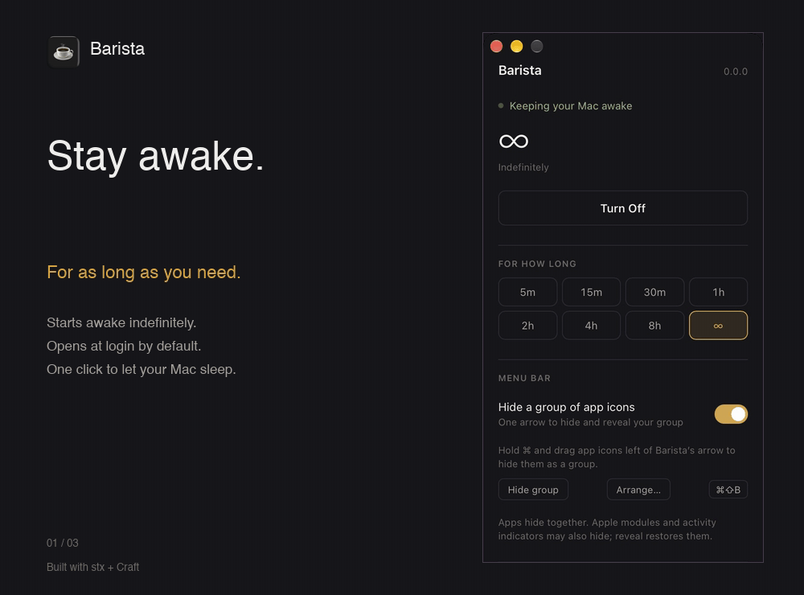

<p align="center"></p>

[![GitHub Actions][github-actions-src]][github-actions-href]
[](https://img.shields.io/badge/platform-macOS-lightgrey.svg)

# Barista

> Keep your Mac awake. Keep your menu bar tidy.

Barista keeps your Mac awake from the menu bar, with timed or indefinite sessions.
Barista starts in the menu bar with its preferences hidden. Left-click the cup
to start or stop; right-click for durations and preferences.
A separate compact arrow hides and reveals a group of menu bar icons you choose with native ⌘-drag.

Built with [stx](https://github.com/stacksjs/stx) and
[Craft](https://github.com/craft-native/craft), using the system WebKit view
and native macOS power assertions. The packaged app includes its own runtime.

## Features

- **Caffeinate, primarily** — Prevent system sleep, display sleep and idle sleep with customizable durations (5m, 15m, 30m, 1h, 2h, 4h, 8h, indefinite). **Left-click the cup** to brew or stop; the icon fills while your Mac is awake and the remaining time is on hover.
- **Right-click for everything else** — A native menu with the current status, durations, preferences and updates.
- **Awake on startup** — Start awake indefinitely by default, including after login. Turn off Start Awake or Open at Login in Preferences if you prefer.
- **Global hotkey** — ⌘⇧C toggles keep-awake.
- **Native icon grouping** — ⌘-drag unwanted icons left of Barista’s arrow, then click it to hide or reveal the group. One compact control, with no pipes or wide spacer. ⌘⇧B toggles the group. Craft restores the bar if macOS also hides an unselected app icon. Identifiable Apple controls, including Wi-Fi and Battery, follow the same boundary.
- **Launch at login** — Start Barista when you log in.
- **Self-updating** — Checks its own GitHub releases, verifies the download by SHA-256 and Apple notarization, requires Barista’s signing team, and installs before restarting the full app.
- **Native integration** — Native status items, menus, keyboard shortcuts and power assertions, with a system WebKit preferences view.
- **Beautiful UI** — Dark-themed popup window with intuitive controls.

## Get Started

The packaged download requires macOS 15 or newer on Apple Silicon, matching the bundled Craft runtime.
Icon hiding requires macOS 27, the direct build and Accessibility access.

Download the DMG from [GitHub Releases](https://github.com/stacksjs/barista/releases/latest),
open it and drag **Barista** to **Applications**. Launch Barista from there.
It starts awake indefinitely and opens at login by default. Right-click the cup
for Preferences, durations and updates.

To build from source, install dependencies with Pantry and Buddy:

```bash
pantry install
bun install
pantry run dev
```

## Choose your hidden group

1. Open Preferences and enable **Hide a group of menu bar icons**.
2. Choose **Open System Settings…** and enable Barista under **Privacy & Security → Device Control and Data Access** (the macOS 27 Accessibility permission).
3. Choose **Arrange…**, then hold ⌘ and drag unwanted icons left of Barista’s arrow.
4. Click the arrow, choose **Hide Grouped Icons**, or press ⌘⇧B. Click again to reveal.

Keep Barista’s arrow visible while hiding a group. If macOS places the arrow in
its overflow, reveal it there first so Craft can read the group boundary.

Barista follows [Hidden Bar’s current native visibility approach](https://github.com/dwarvesf/hidden).
Craft reads the arrangement through Accessibility and hides applications through
the private macOS MenuBarClientCore API. Apps with several icons hide together;
an icon kept on the visible side keeps its app visible. Wi-Fi, Battery and other
identifiable Apple controls also follow the arrow’s boundary. The cup can sit on
either side of the arrow and always remains visible. Grouping follows the display
containing the arrow; native visibility applies to the selected app or Apple
control across displays. Craft checks the visible
side after activation. If macOS hides an unselected app icon, it
releases the restriction, restores the bar and reports the failure. An empty
group leaves everything revealed. Apps launched while collapsed may remain
hidden until you reveal the group.

If verification fails, Barista opens Preferences to explain why it restored the
bar.

The private API is not reliable for every arrangement. On macOS 27.0.1 it can
suppress Apple modules such as Focus, Now Playing and camera/microphone activity
indicators even when system items are allowed. Barista explicitly accepts that
behavior, matching Hidden Bar. Reveal the group to restore those modules.
Craft still protects unselected app icons and preserves the native signing
identities of visible applications and helpers. Apps sharing an identity remain
visible together if any of their icons are on the visible side.

The group is revealed on launch. Disabling grouping, quitting, permission loss or
an activation error restores icons. Apple can change the private API, so this
feature reports unavailable instead of falling back to a wide spacer. It is for
direct distribution and cannot be used in App Store submissions.

macOS still owns system overflow when the revealed icons exceed available space,
including its presentation over app menus. Barista does not widen a status item or
replace that system control. Keep-awake works independently on macOS 15 and newer.
Upgrades preserve awake, duration, login and Dock choices while retiring the old
separator, always-hidden and auto-collapse settings.

## Development

```bash
# Run the app in development mode
pantry run dev

# Lint
bun run lint
bun run lint:fix

# Build a distributable .app + .dmg
pantry run build
```

Set `APPLE_SIGNING_IDENTITY` for a signed direct build. Direct builds use
`barista.direct.entitlements` for the Bun host. App Store packaging is refused
because native icon hiding uses a private API.

## Releases

Release credentials live locally in `.env`. Prepare `.env.production` from the
local signing and notarization values, then encrypt it with Buddy Env before
staging it:

```bash
bunx --bun @stacksjs/buddy@0.75.283 env:encrypt --file .env.production --file-keys .env.keys
```

Commit only the encrypted `.env.production`. Keep `.env`, `.env.keys`, `.p8`
and `.p12` files private. GitHub stores `DOTENV_PRIVATE_KEY_PRODUCTION` as a
repository secret. Release CI decrypts credentials into temporary runner files,
imports the Developer ID identity with Pantry, notarizes and staples the app and
DMG, then removes the plaintext files.

When refreshing a credential, start from the existing encrypted file so Buddy
can retain its encryption key. If you create a new key, update the matching
GitHub repository secret from `.env.keys` before releasing.

After verification, `bun run release:patch` creates and pushes the next version
tag. The release workflow publishes the DMG and `update.json` only after testing
the packaged app and read-only DMG. Installed copies download the update in the
background; **Install and restart** becomes available after the download verifies.

The README animation uses screenshots of the packaged native app. After
refreshing the captures in `.github/art/demo/`, regenerate it with
`bun scripts/generate-demo.ts` (requires FFmpeg through Pantry).

## Verification

```bash
bun run check
pantry run build
bun run test:native
```

The native E2E suite clones and signs the packaged `.app` with unique app and
runtime identities, an isolated preference profile and an empty working directory.
It uses only system tools on PATH, waits for its real WebKit view to initialize the tray and shortcuts, checks
macOS power assertions, switches timed/indefinite sessions, validates rejected
inputs, verifies the selected native backend and compact control, and checks shutdown and Start Awake after relaunch. CI verifies an ad hoc signed bundle and runs it
against both the packaged app and its read-only DMG before release publishing. Timed expiry is covered in stx's native
power tests. Craft also tests cancelled and late activations, errors, permission revocation and cleanup. Physical ⌘-drag placement still requires a macOS desktop check.

## Architecture

The app source is TypeScript and `.stx`; Swift and Kotlin belong outside this app.
Native implementation stays in stx/Craft, exposed through their public APIs.

Barista is a [stx](https://github.com/stacksjs/stx) menu bar app. `@stacksjs/stx`
is the only dependency — it wraps [Craft](https://github.com/craft-native/craft), the
Zig-powered native webview, and the desktop APIs (power management, preferences,
system tray) behind one package.

`createMenuBarApp` from `@stacksjs/stx/menubar` owns the local server, the
preference store and the login item, so the app is a declaration rather than a
runtime:

```
app.ts                 createMenuBarApp: context, routes, tray menu
build.ts               Compile + package the direct app and DMG
src/barista.stx        The popup — signals-driven, no vanilla DOM code
src/caffeinate.ts      Named wrapper over the desktop power API
src/tray.ts            The menu bar item: its cup icon and its menu
src/durations.ts       The durations the popup and tray both offer
src/preferences.ts     Preference shape and defaults
src/updates.ts         Self-update from GitHub releases
```

See the stx guide, [Menu Bar Apps](https://github.com/stacksjs/stx/blob/main/docs/guide/menubar.md),
for the pattern.

## Contributing

We welcome contributions! Please feel free to submit a Pull Request.

## Credits

- [Hidden Bar](https://github.com/dwarvesf/hidden) for the grouping interaction and native visibility API research
- [Bartender](https://www.macbartender.com)
- [Chris Breuer](https://github.com/chrisbbreuer)
- [All Contributors](../../contributors)

## Sponsors

We would like to extend our thanks to the following sponsors for funding Stacks development. If you are interested in becoming a sponsor, please reach out to us.

- [JetBrains](https://www.jetbrains.com/)
- [The Solana Foundation](https://solana.com/)

## License

The MIT License (MIT). Please see [LICENSE](LICENSE.md) for more information.

Made with 💙

<!-- Badges -->
[github-actions-src]: https://img.shields.io/github/actions/workflow/status/stacksjs/barista/ci.yml?style=flat-square&branch=main
[github-actions-href]: https://github.com/stacksjs/barista/actions?query=workflow%3Aci
